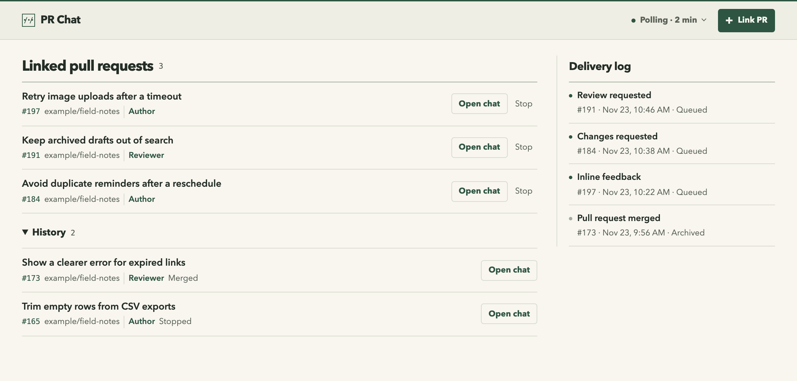
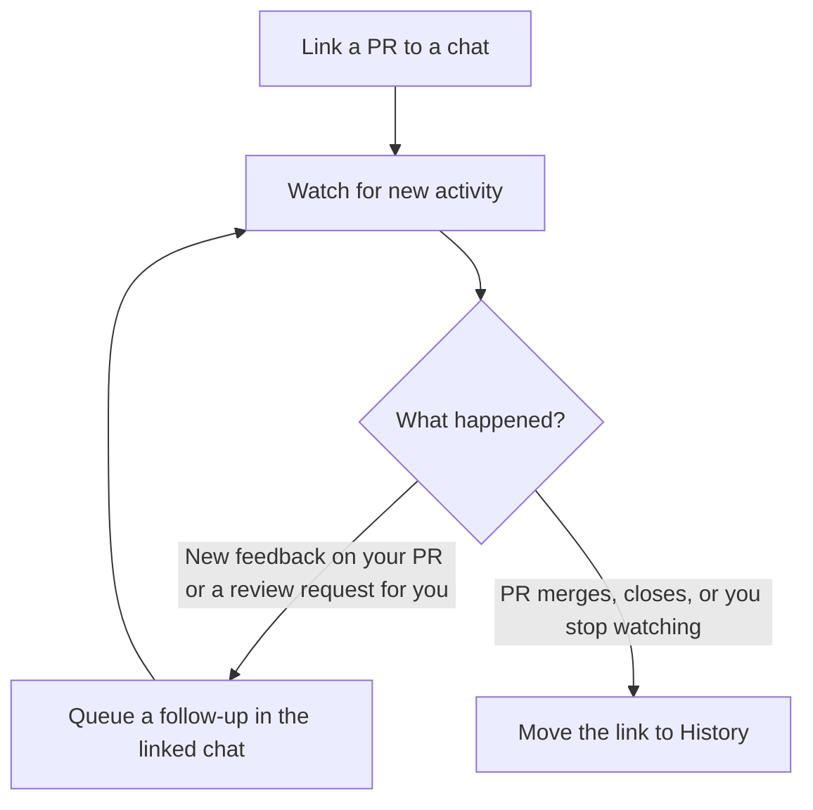

# PR Chat

I kept checking GitHub to see whether someone had responded to a review. The chat where I did the work already had the context, so I built a way to link it to the PR once and come back when there’s something to do.



## What it watches

- **Your PRs.** Changes requested, reviews with written feedback, and new inline review comments from other people.
- **PRs you review.** Review and re-review requests assigned to your GitHub account.

Each watch starts with new activity after you link the PR. Approval keeps it open for another round. Closing or merging moves the link to History. You can stop a watch anytime.

## How it works

PR Chat uses your existing `gh` login to check linked PRs every two minutes. Click the polling status in the toolbar to change the interval. Links and delivery history live in SQLite on your Mac.

New feedback starts a follow-up in the linked Codex chat. For your own PR, the chat can work through feedback in a clean checkout at the current PR head. For a PR you review, it checks what changed and drafts findings in chat. GitHub reviews, replies, and pushes are yours to send.

Keep the dashboard on your Mac. Author feedback can start local work in Codex with the chat’s existing permissions, so use author watches with repositories and reviewers you trust.

### Watch lifecycle



## Get started

You’ll need macOS, Node 24+, a signed-in GitHub CLI, and a local Codex desktop app with `codex queue --resume` support. From this checkout, run:

```sh
npm ci
PR_CHAT_GH="$(command -v gh)" npm start
```

Open the [dashboard](http://127.0.0.1:4317), click **Link PR**, and paste the PR URL and the chat link. In Codex, **⌘⌥L** copies the chat link. Keep the app running while you want it to check GitHub.

If your delivery CLI is installed elsewhere, set `PR_CHAT_CODEX` to its absolute path when starting the app.

## Link from a chat or the terminal

Run `npm link` from this checkout to put `pr-chat` on your PATH. In a Codex chat, run `pr-chat link <PR URL>`. In your terminal, pass the chat link too:

```sh
pr-chat link https://github.com/owner/repo/pull/123 'codex://threads/<chat-id>'
pr-chat list
pr-chat unlink https://github.com/owner/repo/pull/123
```

Add `--worktree /absolute/path` if the PR has its own checkout. The [PR Chat skill](skills/pr-chat/SKILL.md) lets you do the same thing by asking in chat. [Optional hooks](docs/codex-hooks.md) can link PRs when Codex opens or reviews them.

Run `npm test` to check the watch and delivery transitions and exercise polling through the local app. The state machines use a pinned XState 6 beta. There’s also an [optional push relay](docs/push.md) if you want GitHub webhooks.
