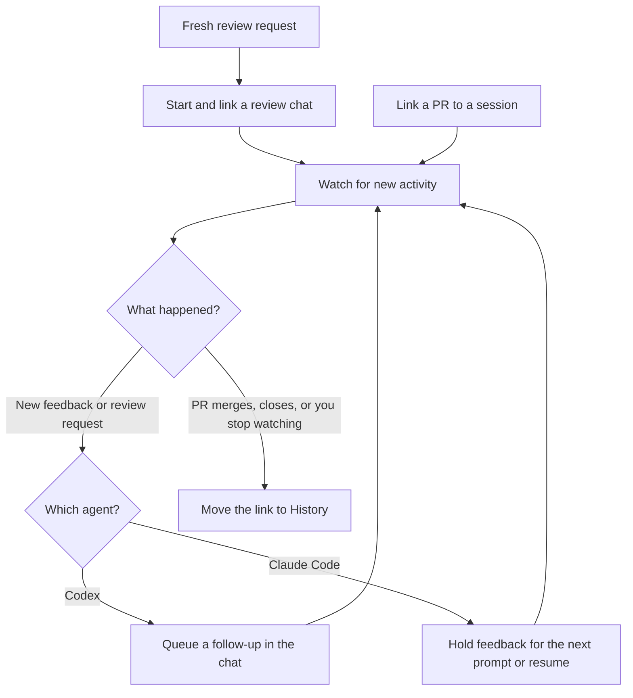

# Review Relay

I kept checking GitHub to see whether someone had responded to a review. The chat where I did the work already had the context, so I built a way to link it to the PR once and come back when there’s something to do.


## What it watches

- **Your PRs.** Changes requested, comment-only reviews with a note, and new inline review comments from other people.
- **PRs you review.** Review and re-review requests assigned to your GitHub account.

Each watch starts with new activity after you link the PR. Approvals are silent and keep the watch open for another round. Closing or merging moves the link to History. You can stop a watch anytime.

## How it works

Review Relay uses your existing `gh` login to check linked PRs every two minutes. Click the polling status in the toolbar to change the interval. Links and delivery history live in SQLite on your Mac.

Review Relay adds a follow-up to the linked Codex chat's queue. If the chat is closed, open it in Codex to pick up the follow-up. This keeps the chat's stop and steer controls available where it runs. Claude Code picks up waiting feedback when you resume the linked session or send your next prompt. With `terminal-notifier` installed, you also get a macOS notification when feedback arrives.

For your own PR, the agent can fix feedback in a clean checkout, run focused tests, and commit and push the fixes to the PR branch. After pushing, it can request re-review from the reviewers whose requested changes it addressed. You handle replies and thread resolutions. For a PR you review, the agent checks what changed and drafts its findings in the session. Keep the dashboard on your Mac and use author watches with repositories and reviewers you trust.

### Watch lifecycle



## Get started

You’ll need macOS, Node 24+, a signed-in GitHub CLI, and either the Codex desktop app or Claude Code. Run these from this checkout.

```sh
npm ci
npm link
pr-chat init
PR_CHAT_GH="$(command -v gh)" pr-chat start
```

`pr-chat init` adds hooks and installs the skill for both agents. Pass `codex` or `claude` to set up just one. It keeps existing skills and other hooks. In Codex, use `/hooks` to trust new hooks. If your Codex delivery CLI is installed elsewhere, set `PR_CHAT_CODEX` to its absolute path when starting the app.

Open the [dashboard](http://127.0.0.1:4317) to see your watches and their delivery history. Keep the app running while you want it to check GitHub.

## Open chats for new reviews

In **Settings → Review chats**, pick Codex or Claude Code and enter the full path to a trusted GitHub checkout. You can enter the GitHub repository as `owner/repo` or leave it blank to use the checkout’s origin. Review Relay checks that repository for direct review requests to your `gh` account. It starts a chat for requests made after you enable the setting. Previously reviewed or linked PRs keep their existing workflow.

Codex uses GPT-6.2 Sol on the desktop app’s local server. Claude Code uses Opus 5.5 in a background session. For Claude, open the checkout in Claude Code once and accept its trust prompt, then use **Copy attach command** to join the session from a terminal. Your account needs access to the selected model. The new agent drafts its review in the chat and asks before posting anything to GitHub.

Set **Review skill** to the name of a skill in your Codex or Claude Code user settings. The default is `pull-request-review`. Claude Code can also use the copy in your Codex settings. If the skill is missing, Review Relay uses a plain read-only prompt. The setting applies to new review chats and re-review prompts.

New review chats appear in the **Delivery log**. Click **Open new review chat** to jump to Codex or copy the Claude Code command. Codex chats created by Review Relay appear under **Tasks**.

Fresh requests are checked on the same interval as linked PRs, even when linked PRs use a push relay. If a launch can’t be confirmed, check Settings for the PR number. You can link that review manually.

## Link from a chat or the terminal

Use `$pr-chat` in Codex or `/pr-chat <PR URL>` in Claude Code. You can also run `pr-chat link <PR URL>` from either agent. The hooks can link new PRs opened through `gh pr create`, including several opened by one command, and review prompts with the configured skill, such as `$pull-request-review`, and a single PR reference.

From a separate terminal, pass a session reference explicitly.

```sh
pr-chat link https://github.com/owner/repo/pull/123 'codex://threads/<chat-id>'
pr-chat link https://github.com/owner/repo/pull/456 'claude:<session-id>'
pr-chat list
pr-chat unlink https://github.com/owner/repo/pull/123
```

Add `--worktree /absolute/path` if the PR has its own checkout. In the dashboard, **Open chat** opens Codex, and **Copy resume command** gives you the command to reopen a Claude Code session from its checkout.

The **Delivery log** shows whether a follow-up is waiting, queued in Codex, handed to Claude Code, or failed. For an active watch, **Requeue** sends an accepted follow-up again and **Retry** attempts a failed delivery.

## Development

The reviews domain lives in `api/domains/reviews`. Cricket loads its routes, service, and two state machines. The machines take the current state and an event and return the next state. Cricket manages the SQLite connection. Review Relay runs its inbox migrations during setup. The service saves transitions in a transaction. Jobs poll GitHub, queue Codex feedback, and send desktop notifications. The worker runs inside the app and reads pending work from SQLite after a restart. Cricket’s local queue coalesces wakeups for polling and delivery.

Run `npm run inspect` to see the routes, machines, and jobs. Run `npm test` to exercise the watch and delivery flow through the local app. CI runs `npm run check` before the tests to check formatting, lint rules, and the Cricket app.

There’s also an [optional push relay](docs/push.md) if you want GitHub webhooks.
